# Maze Solving Neato

Computational Robotics 2026 \- Harlan Haller and River Lewis

# Project Intro

## Assignment

This project was developed for the Machine Vision project in Computational Robotics. This is a very open-ended project that broadly requires a team to implement any system involving machine vision and robotics, including at least one machine-vision-related algorithm.

## Our goal

We decided to make a Neato robotic vacuum solve a maze on the floor given an overhead view of the maze, its initial pose within the maze, and a goal pose. We expected that this goal would allow us to work on camera calibration and image rectification, obstacle detection, path planning, and path following.  
![][image1]  
*Figure 1\. The maze, laid out in blue-and-white checker tape on the floor, framed by AprilTags to assist with ground recognition, and with a camera on a tall tripod providing an overview.*

# Demo

[Demo video on YouTube](https://youtu.be/HIFwmUiVgKU)

# Methods and Algorithms

## Vision

The overall goal of this section is to take an image of our maze laid out on the floor (constructed of blue and white checker tape as seen in Figure 1\) with 4 april tags to determine scale, and convert this image into a bit map with defined real-world size that can be fed into a map server. This rough flow is shown in Figure 2\.

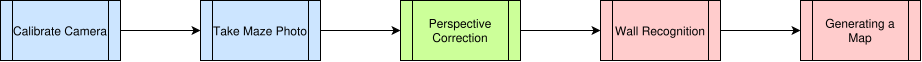

*Figure 2\. High level overview of the steps behind the vision system.*

### Getting the Maze Photo

The first steps are to perform calibration on our camera to find its intrinsic matrix, which we will need for accurate distance calculations later, and to actually get a photo of the maze and apply the calibration found then save it for future processing. These are all performed by the set of scripts in the `src/maze_solver/tools` folder. Figure 3, and this section, provides a high level overview of the order and purpose of each script and all the data stored by them. For an in depth overview of how to use each tool see [src/maze\_solver/tools/README.md](https://github.com/rivques/maze_solving_neato/blob/main/src/maze_solver/tools/README.md).

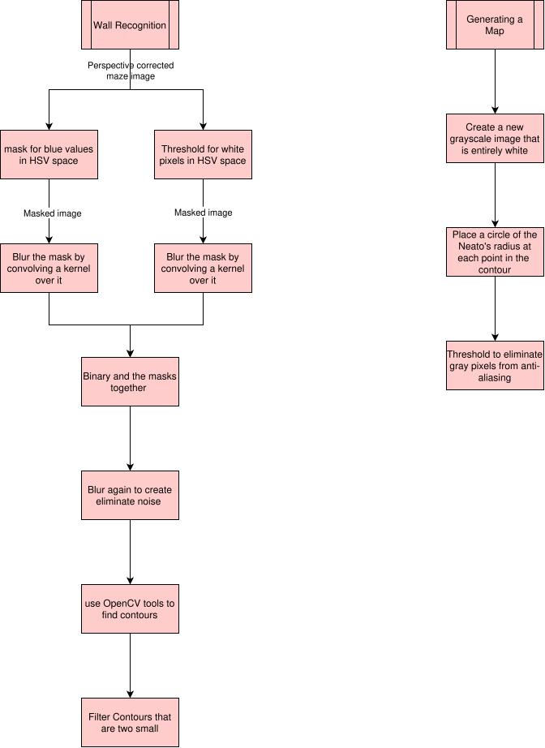  
*Figure 3\. Overview of the subprocess used to calibrate the camera and save a calibrated maze photo*

1. `get_calibration_data.py`  
   This script simply displays a video feed and provides the functionality of pressing the ‘s’ key to save the current video frame as an image. To use this script to calibrate a camera first print out a checkerboard pattern using [calib.io](https://calib.io/pages/camera-calibration-pattern-generator). Run this script (as directed in the tools folder readme) and hold the checkerboard patter in front of the camera. Position the pattern at a variety of positions and angles within the camera view pressing ‘s’ at each position. Photos are saved under tools/test\_frames/. An example calibration image is shown in Figure 4\. This script can be bypassed using a camera app of your choice, just ensure that it saves images in the correct naming scheme (outlined in tools readme)  
2. `calibrate_camera.py`  
   This script relies on having previously captured calibration images under tools/test\_frames. It imports these images and runs calibration as described in [this demo](https://docs.opencv.org/4.13.0/dc/dbb/tutorial_py_calibration.html) from OpenCV. This gets us calibration data in the form of numpy matrices, which we store as calibration\_data.npz.  
3. `get_maze_photo.py`  
   This script is very similar to `get_calibration_data.py`, It provides a video feed with the ability to save photos using ‘s’, however, this script also uses the saved calibration\_data to display a calibrated video feed and save a calibrated maze photo when triggered. Additionally this script shows an outline around every detected april tag to show visually which AprilTags are detected for the current frame. When all four AprilTags are detected the program will automatically save a photo. An example maze photo is shown in Figure 5\.  
     
     
   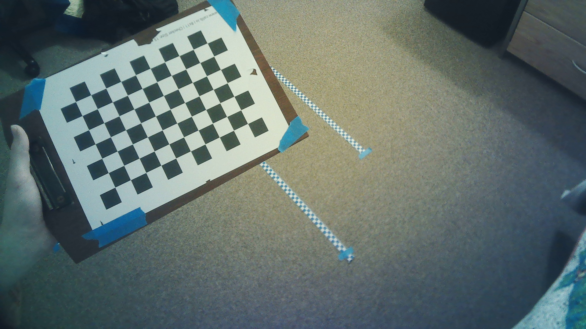

*Figure 4\. Example calibration photo.*  
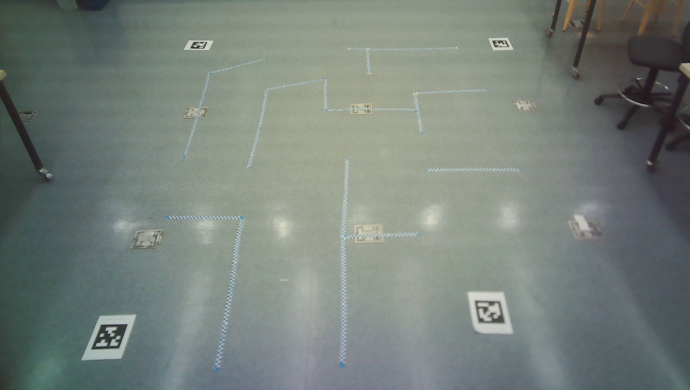
*Figure 5. Example maze photo. This is the photo is the final version we used for the demo.*

### Correcting for Camera Perspective

The next step in the vision pipeline is to use the four AprilTags in the saved maze photo to correct for the camera's perspective and get accurate sizing data. The ultimate goal of this section is to calculate and use a homography matrix to warp the perspective of our image to be top down. OpenCV provides a method to calculate the homography matrix given a set of source and destination points in pixel coordinates. These pairs define where given pixels in the original image should end up in the desired image. In our case we want to move each april tag center to a position in a new image that will give a top down perspective while retaining the relative scale of everything within the image. The resulting homography matrix can then be used to transform the entire image such that every source point ends up at each destination point. This process is handled by the function `unwarp_image` provided by `april_tag_detect.py` file. An overview of our implementation of this process can be seen in Figure 7.The input to this process is an image from the camera’s perspective like Figure 5, and the output is a top down image of known scale as shown in Figure 6.

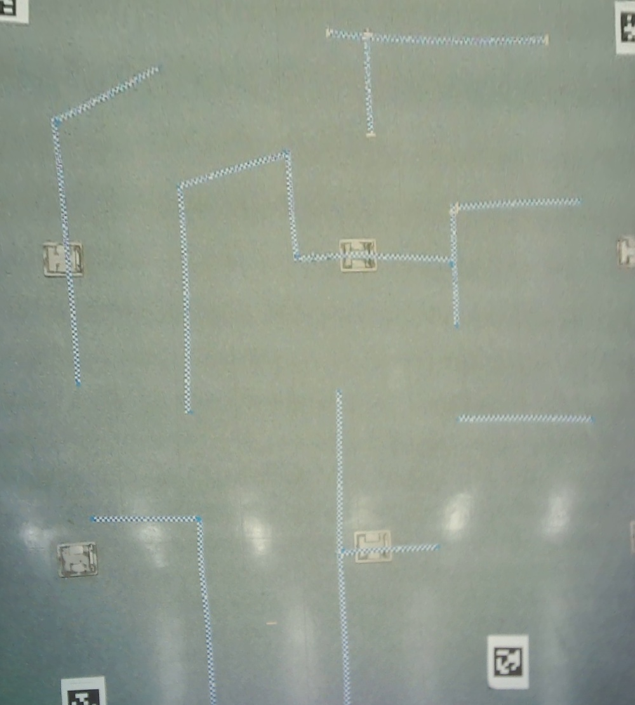  
*Figure 6. This is an example output from the unwarp\_image function. The resolution of this image is 0.0034 meters per pixel.*  
*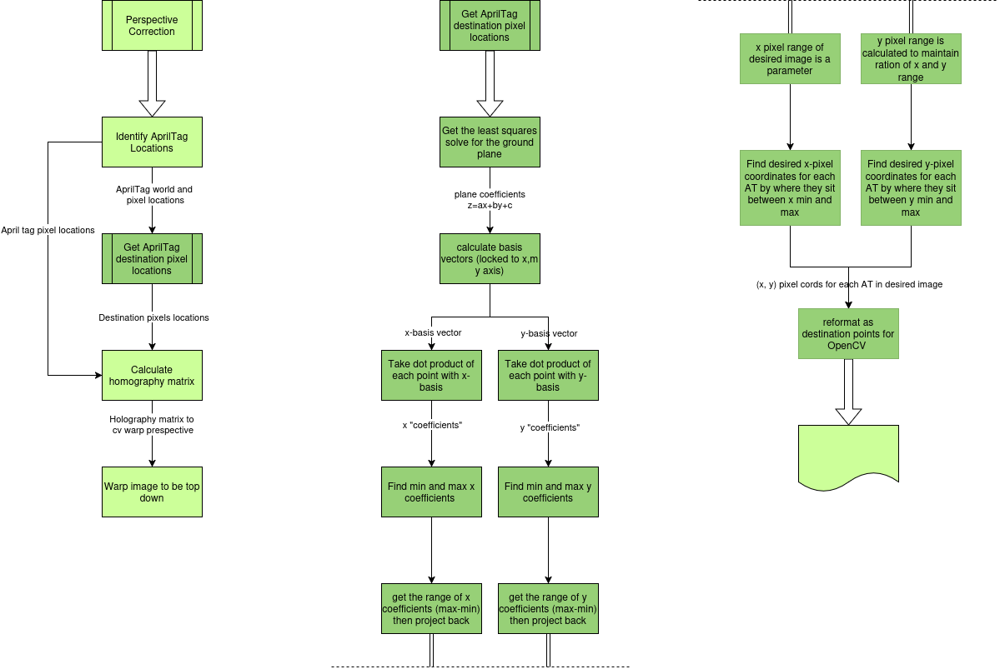*

*Figure 7. Overview of the process of correcting for camera perspective.*

1. Identifying AprilTag locations  
   For our AprilTag detection we use [dt\_apriltag](https://github.com/duckietown/lib-dt-apriltags) which provides python bindings for the [AprilTag 3](https://github.com/AprilRobotics/apriltag) library. This allows us to easily identify april tags in our image and get their pixel locations within our image. When provided with the proper calibration data and the size of the april tags we are using this library also provides the estimated world position for each AprilTag. This coordinate is relative to the camera, where the z direction is positive further from the camera parallel to its line of sight, and the x and y values are horizontal and vertical within the image respectively.  
2. Get AprilTag destination pixel locations  
   This section contains the bulk of the math. The high level approach we took was to project each AprilTag onto the plane then find a bounding box within the plane that contains each AprilTag. Finally we calculate where each AprilTag would fall within an image (by pixel coordinates) taken normal to the bounding box, given its positions within the bounding box. We used a Matlab script to develop our mathematical algorithm. The MatLab script used is included at the top level in our repository. A visualization generated by the script is shown in Figure \#.  
    1. Get least squares solve for plane

   Where X, Y, Z are column vectors containing the position of each AprilTag
   
$$
\mathbf A = \begin{bmatrix}  \mathbf{1} & \mathbf{X} & \mathbf{Y} \end  {bmatrix} \\
$$

    Equation 1.

   In Equation 1 we define A where **1** is an appropriately sized column vector of ones. Then we solve Equation 2 to get a least squares solve for C where C has the form $C=[a,b,c]'$ where $z=a+bx+cy$

$$
\mathbf Z = \mathbf A \mathbf C
$$

    Equation 2.

    2. Find basis vectors

   In Equation 3.1 and 3.2, we define two basis vectors locked to the x and y axis within the calculated plane.

$$
\begin{align}
x_{basis} = \begin{bmatrix} \frac{1}{\sqrt{1+b^2}} \cr 0 \cr \frac{b}{\sqrt{1+b^2}} \end{bmatrix} \qquad (1) \\
y_{basis} = \begin{bmatrix} 0 \cr \frac{1}{\sqrt{1+c^2}} \cr \frac{c}{\sqrt{1+c^2}} \end{bmatrix} \qquad (2) 
\end{align}
$$

    Equation 3.

   Both of these vectors are normal however they are not orthogonal. While this does make some calculations later slightly wrong they are only non orthogonal by a very small amount so the error is not noticeable for our purposes.

    3. Find x and y coefficients

   For the purposes of calculations we define the matrix P to contain each AprilTags location as a column vector as shown in Equation 4\.

$$
\mathbf P = \begin{bmatrix}  \mathbf{X'} \cr \mathbf{Y'} \cr \bf{Z'} \end{bmatrix}
$$

    Equation 4.

   We find the "coefficient” for how far in the x and y direction each point is by taking the dot product of each basis and **P**. In Equation 5.1 and 5.2 we define to ${x}_{coeffs}$ and ${y}_{coeffs}$ as the list of these coefficients

$$
\begin{align}
\mathbf {x}_{coeffs} = \mathbf{x}_{basis}'\mathbf{P} \qquad (1) \\
\mathbf {y}_{coeffs} = \mathbf{y}_{basis}'\mathbf{P} \qquad (2)
\end{align}
$$

    Equation 5.

    4. Find x and y min and max coefficients

   Next we define ${x}_{max,\ c},\ {x}_{min,\ c},\ {y}_{max,\ c},\ {y}_{min,\ c}$ as the maximum and minimum values of ${x}_{coeffs}{\ }$and ${y}_{coeffs}$ respectively.

    5. Find the range (in meters) within the plane in the x and y basis direction

   We can find the difference in coefficients in the x and y direction by taking $max-min$ for each one. To find the actual in meters range within the plane we project this difference back into our plane by multiplying the basis vectors by their respective range and finally taking the Euclidean norm. This is shown in Equations 6.1 and 6.2

$$
\begin{align}
\mathbf{x}_{range} = \mathrm{norm} (\mathbf{x}_{basis}(x_{max,c} - x_{min,c})) \qquad (1) \\
\mathbf{y}_{range} = \mathrm{norm} (\mathbf{y}_{basis}(y_{max,c} - y_{min,c})) \qquad (2)
\end{align}
$$

    Equation 6.

    6. Calculate the number of y pixels

   The number of pixels on the x (horizontal) axis is defined as a parameter to the function. We calculate the y size of the output image such that the relative distances in the world and the result image are the same. That means the ratios ${x}_{pixels}\ /\ {y}_{pixels}\ =\ {x}_{range}\ /{y}_{range}$ must be equal. We define $\ {y}_{pixels}$ so that is the case in Equation 7

$$
y_{pixels} = x_{pixels} * (y_{range} / x_{range}) 
$$

    Equation 7.

    7. Find desired x and y coordinates for each AprilTag

   To find where each april tag should appear in our new image where its x and y coefficients fall proportionally between our min and max coefficients on each axis then rescale this fraction to be of our pixel range. These new values are calculated as shown in Equation 8.1 and 8.2. Because we previously set the ratios of sizes in the world equal to the ratio of sizes in pixel ranges.  


$$
\begin{align}
AT_x = ( \mathbf {x}_{coeffs} - x_{min,c} ) / (x_{max,c} - x_{min,c}) x_{pixels} \qquad (1) \\
AT_y = ( \mathbf {y}_{coeffs} - y_{min,c} ) / (y_{max,c} - y_{min,c}) y_{pixels} \qquad (2)
\end{align}
$$

   Equation 8.

    8. Reformat as destination points for open CV

   Finally in code we reformate the lists of x and y pixel coordinates for the april tags into a 4-by-2 numpy array. This is simply a matter of indexing into the output list and storing the results in a new numpy array.

   

   

3. Calculate the homography matrix  
   To calculate the homography matrix we use the build in OpenCV function `cv2.findHomography` while providing it with our list of source points taken from where the AprilTag detector found the center of each AprilTag and the calculated AprilTag location  
4. Warp the image perspective  
   Finally we use the OpenCV function `cv2.warpPerspective` providing it our image and the homography matrix. This gives us a new top down image as shown in Figure 6.  
     
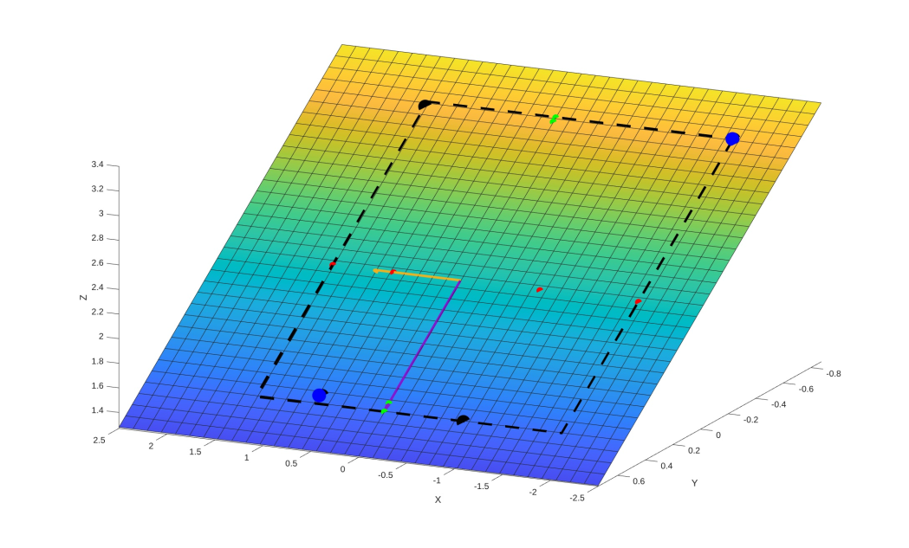

*Figure 8\. This figure shows a visualization in MatLab of many of the calculated values in the ground plane rectification algorithm and some additional features. The blue points represent the world positions of the AprilTags. The surface represents the least squares fit for the ground plane. The yellow vector shows the x basis vector and the purple vector shows the y basis vector. The red and green points show the projections of each April tag location onto the x and y basis vectors respectively. The black points are the AprilTag world positions projected onto the ground plane. The black dashed line represents the calculated bounding box (x\_min to x\_max, y\_min to y\_max). The new image contains this region.*

### OpenCV Processing

In this section we take the image with a corrected top down perspective and use OpenCV tools to find the blue and white checkered tape that serves as the walls in our maze. Once we have the contours we then prepare a map to be used by the map server. The overview of this process is shown in Figure 9\.  

*Figure 9\. Overview of OpenCV processing steps*

1. Mask for blue pixels  in HSV space  
   To filter for blue pixels we map the HSV space. We made tools to display trackbar which we can adjust whenever running the program in a new environment. The imaged masked for blue can be seen in Figure 10. 
2. Mask for white pixels with in HSV space  
   To mask for white pixels we threshold on all possible values of hue and saturation and only place a lower bound on acceptable value values. The lower bound for value can be set by a trackbar for new environments.  The image masked for white can be seen in Figure 10.
3. Blur each mask  
   Next we blur each mask by convolving a kernel of all 1s over the image. The kernel size can be set by a track bar when adapting the filter to a new environment. This ensures that there will be overlap between the blue regions and the white regions of the blue and white checkered tape.  
4. Combine the masks  
   Next we take the binary and between our masks. There will always be areas of similar blue or white in the image that can cause noise so we filter for areas where blue and white are next to each other. The blurring in the masks allow us to and the masks together to mostly isolate our areas of interest.  
5. Filter  
   After combining the masks, we convolve another kernel over the image to filter out noise and make the areas of interest more solid.  
6. Find contours  
   We use the OpenCV function `cv2.findContours` to identify contours in the image. This gets us outlines of the polygonal regions within the image.   
7. Filter contours  
   The contours we find in the image will include some contours that are erroneous. However, these contours tend to be small in area or perimeter, whereas the intended contours are much larger in both. Due to this we can eliminate the erroneous contours by filtering our contours that have a perimeter or area that is too low.

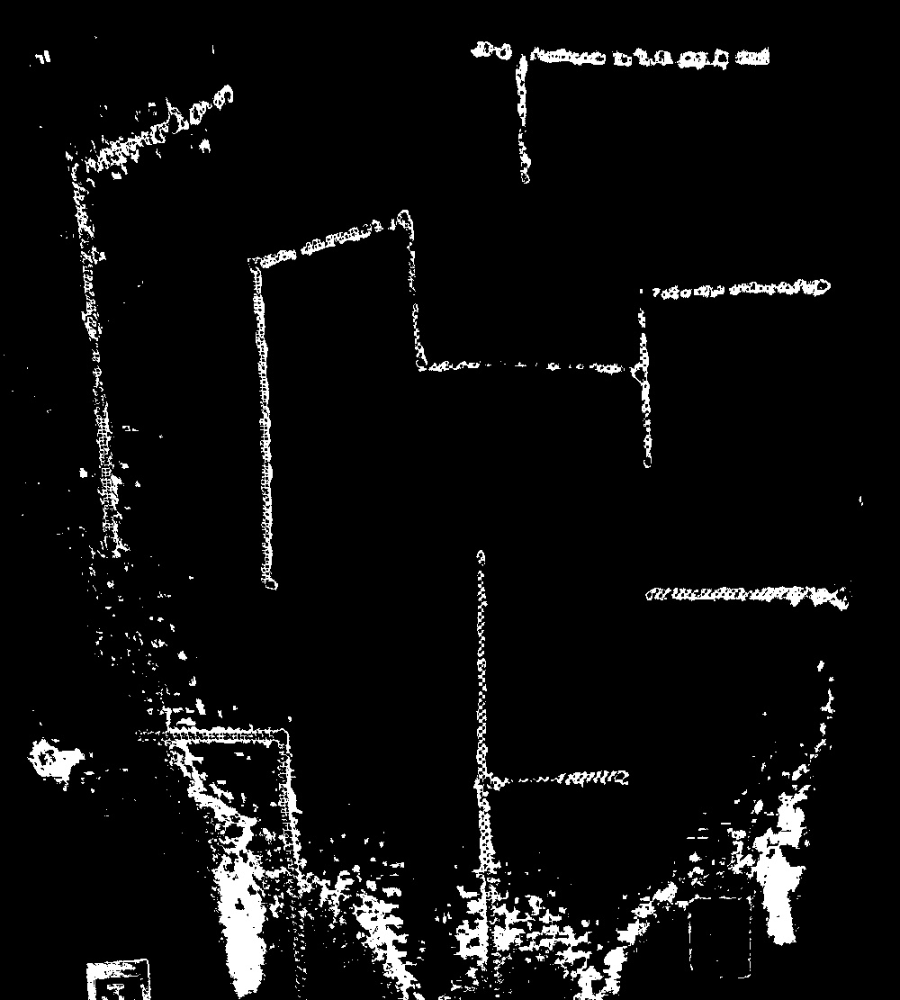
*Figure 10. The maze photo masked to select blue pixels*
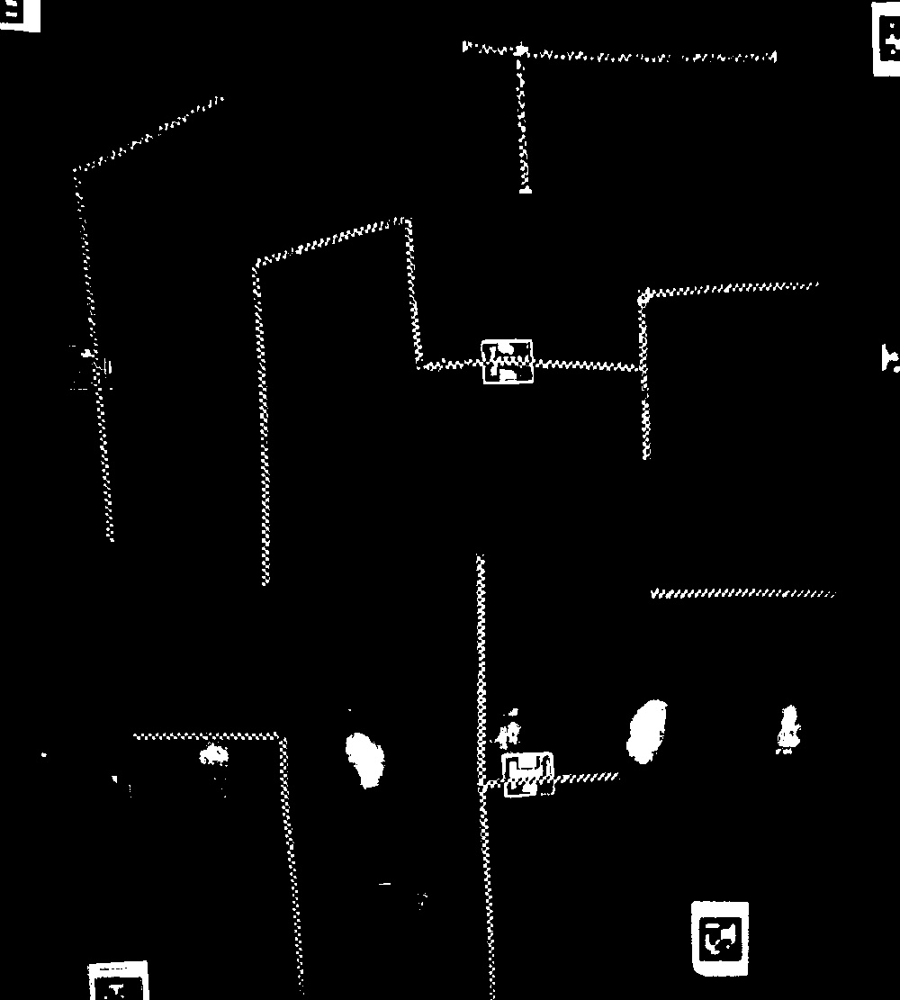
*Figure 11. The maze photo masked to select white pixels*

The contours found from this approach can be seen in Figure 11\.

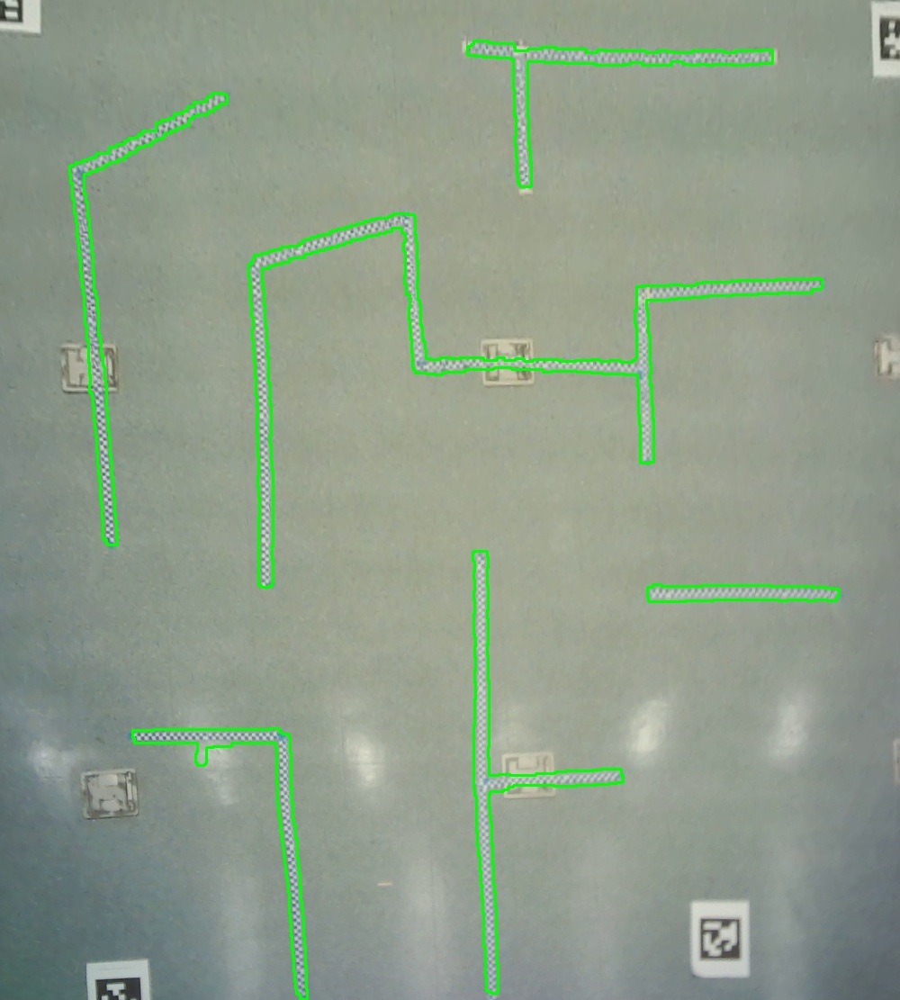 
*Figure 11\. Image generated from our program including the contours found by filtering for the blue and white checkered tape.*

We then need to use this contour data to create a map that can be interpreted by a map server.

1. Create a new grayscale image  
   First we create a new grayscale image to be the base of our map which is set to be the same size as the input image and is generated through `numpy.ones`.  
2. Place a circle at each point in the contour  
   We loop through every point in the contour and place a circle at that point in the map image with the Neato’s radius. We do this to ensure the neato can only be in areas that will not have it overlapping the walls.  
3. Threshold to eliminate noise from anti-aliasing  
   We found that the map produced from this method had some noise due to anti-aliasing. We tried simply turning off anti-aliasing however, that gave us very poor results. To fix this we simply thresholded all that were at a very high value to white and left everything else black. This ensures we get every pixel we might want to include thus increasing our margin of error.  
   

An example of a map produced from this approach can be seen in Figure 12\.  
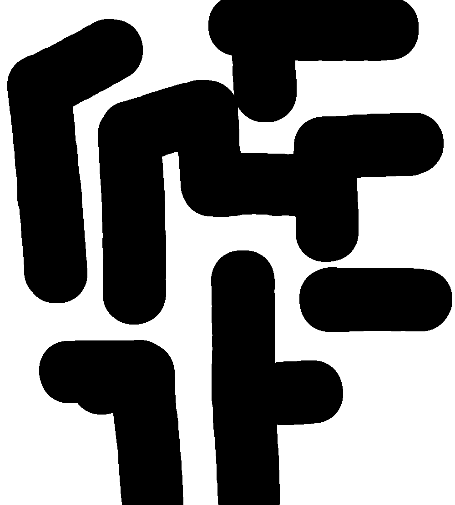
*Figure 12\. Bitmap created by our program based on the contours found previously. We saved our map as a PNG*

## Navigation

We now have a map of the maze. At this point, we move from using Python scripts into running a ROS node to control the Neato robot. The robot follows the state machine shown in Figure 13\.  
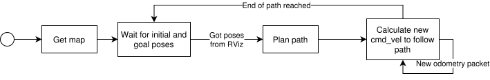  
*Figure 13\. The state diagram of the navigation system. Initial and goal poses are provided from RViz, end of path is detected when the closest point on the path to the Neato is the final point on the path.*

### Breadth-First Search

The first navigation problem is, given the map, an initial pose, and a goal pose, to figure out a path through the maze from the initial pose to the goal pose that will not cross through any maze walls. To do this, we use breadth-first search (BFS), a standard (if simplistic) approach to this type of problem. This approach effectively views the map as a graph, with a node at each pixel that’s free and an edge between all adjacent free pixels. Then, the algorithm explores the graph according to the following rough pseudocode:

```py
start_node = initial_pose.location
frontier = Queue([start_node])
came_from = {}
while frontier is not empty:
	current_node = frontier.get()
	break if current_node is goal_node
	for each free neighbor of current_node:
		if neighbor not in came_from:
			frontier.put(neighbor)
			came_from[neighbor] = current_node
```

When this loop finishes, the `came_from` dict holds as keys all the nodes we discovered from our starting point, with each value being the node from which the corresponding key was discovered. Since every newly discovered node is farther away from the starting point than the node it was discovered from, we can backtrack through `came_from` to find a path from our goal node to our start node:

```py
path_nodes = []
current_node = goal_node
while current_node != start_node:
	path_nodes.append(current_node)
	current_node = came_from[current_node]
path_nodes.reverse()
```

This leaves a list of nodes that lead from the start node to the end node in `path_nodes`. The actual implementation of this algorithm lives in [runner\_logic.plan\_trajectory](https://github.com/rivques/maze_solving_neato/blob/main/src/maze_solver/maze_solver/runner_logic.py#L17), and includes a few extra checks and considerations.  
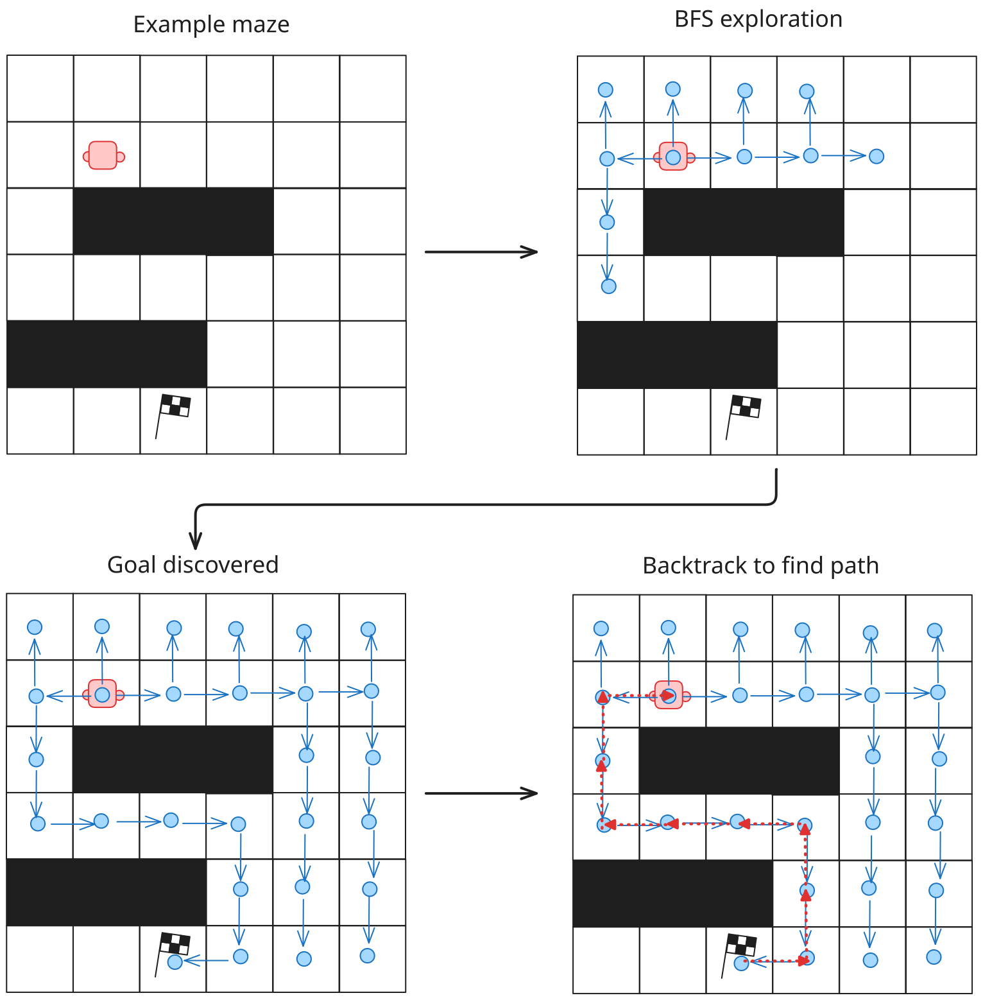
*Figure 14\. A diagram showing the major steps of breadth-first search pathfinding.*

### Pure Pursuit

Now that we have a path, we need to figure out the actual velocity commands to get the Neato to follow that path. To do this, we use an algorithm called Pure Pursuit. The high-level steps of this algorithm are shown in Figure 15\.  
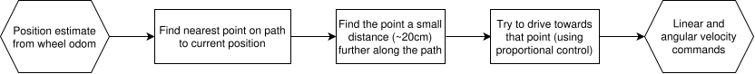  

*Figure 15\. The important steps in the Pure Pursuit path following algorithm.*

This algorithm is simple, though it comes at the expense of not being able to pre-plan velocity and acceleration and having a tendency to cut corners. For our application, this is acceptable, since we don’t particularly care about the velocity of the Neato, as long as it follows the path, and the Neato radius compensation on our maze maps means that we don’t have sharp, cuttable corners at maze walls.

This algorithm is implemented in [runner\_logic.get\_vels\_for\_traj](https://github.com/rivques/maze_solving_neato/blob/main/src/maze_solver/maze_solver/runner_logic.py#L95). The [MazeRunnerNode.odom\_callback](https://github.com/rivques/maze_solving_neato/blob/main/src/maze_solver/maze_solver/maze_runner.py#L142) function handles some setup and state management, and broadcasts some additional debug information.

 

*Figure 16\. An illustration of how the Pure Pursuit algorithm follows waypoints. [Source](https://www.mathworks.com/help/nav/ug/pure-pursuit-controller.html)*

Figure 16 shows how the Neato selects a target point along its path. Given this target point, we use simple proportional controllers to drive the Neato towards the target:  
$$
\begin{gather*}
\vec{V} =  \vec{T}_{/O} - \vec{N}_{/O} \\ 
\epsilon_x = \left|\vec{V}_{/O}\right| \\
\epsilon_{\theta} = \mathrm{atan2}(\vec{V}_y, \vec{V}_x) - N_{\theta} \\
v_x = kP_x \cdot \epsilon_x \\
v_\theta = kP_{\theta} \cdot \epsilon_{\theta}
\end{gather*}
$$

Where $\vec{T}_{/O}$ is the current target point in the odom frame, $\vec{N}_{/O}$ is the Neato’s position in the odom frame, $N_{\theta}$ is the Neato’s yaw angle in the odom frame, $\epsilon_x$ and $\epsilon_{\theta}$ are the linear and angular errors, respectively, and $kP_x$ and $kP_{\theta}$ are the controller’s gains. After testing, we settled on a $kP_x$ and $kP_{\theta}$ of 0.5 m/s/m and 1 rad/s/rad, respectively, as well as a lookahead distance of 20cm. These parameters are tunable with the ROS Param system.
Figure 17 provides an example of what this looks like to the robot in practice: a path is generated, and the Neato proceeds to chase a point along the path.

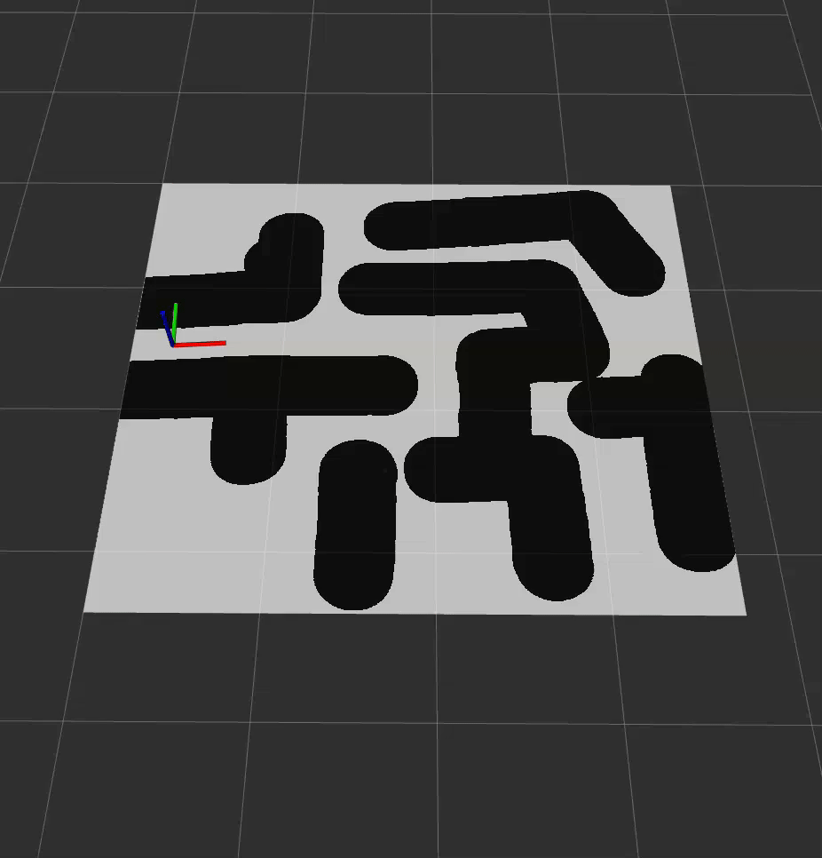
*Figure 17\. An animation of the path planning and following algorithms running. Green is the planned path, red is the actual travelled path, and the small dots moving along the path are the closest point and current target point. The Neato is represented by the axes.*

# Important design decisions

## Overlooking camera

We choose to use a overlooking camera instead of a camera onboard the Neato for a few reasons. First it allows our code to be much more modular. The vision system and the navigation system only overlap through the map created in the vision system. This allows for easier testing and development. Secondly, we did not want to try to get the vision system to run real time. Doing so would prove very difficult and likely require sacrificing quality of vision.  Separating out the vision system allows us to preprocess all vision components.

## Off-the-shelf AprilTag library

Another important design decision was to use an off the shelf AprilTag detection library. Given the time it would take to make our own algorithm for AprilTag detention, and that it would not progress substantially on either of our learning goals, we decided to fuse an off the shelf solution. This allowed us to focus our efforts on the parts of the project we found more interesting and rewarding.

## BFS for pathfinding

Our choice of breadth-first search for pathfinding prioritized simplicity. Breadth-first search has two major drawbacks compared to alternatives: first, it’s inefficient, and doesn’t scale well. In practice this was not a problem for us, and solving for a path at the start of each traversal took perhaps half a second. The more visible issue is that we have no way to favor “nice” paths \- that is, paths that are far from walls, with smooth turns. Instead, we follow the path along the nodes that happened to discover the next closest node. While this is guaranteed to be the shortest path by Manhattan distance, it isn’t necessarily the *best* path. A more advanced pathfinding/graph search algorithm like Dijkstra’s or A-star could take into account, say, a cost associated with being close to a maze wall, and use that information to come up with a qualitatively better path.

## Splitting logic out of ROS nodes

Because of the complexity of testing ROS nodes in the context of a full ROS system, we pulled as much logic as possible out of the ROS node that controls the Neato and into pure functions in `runner_logic.py`. This allows most of the navigation logic to be tested with standard `pytest` unit tests independently of ROS, and enables tools like VSCode’s debugger to work nicely with tests. The downside of this is that we can’t automatically unit test the parts of code that interface directly with ROS constructs, like broadcasters and `tf2`\-related code. These areas of the code are handled by manual end-to-end testing \- in other words, we run the code and make sure the Neato actually does what’s expected of it.

## Pixi

Over the past few projects, we’ve grown frustrated with ROS’s apt-based dependency management, which often resulted in code working on one computer but not on another, Numpy v2.0 vs v1.0 errors, and similar issues. Furthermore, anybody not running Ubuntu 24 had to run ROS in a Docker container, which was an inconvenience. To address these issues, we used [Pixi](https://pixi.prefix.dev) for this project. Pixi is a package and dependency manager, much like Cargo for Rust or uv for Python, that is capable of constructing self-contained, deterministic, portable environments for ROS. The `pixi.toml` file in our workspace root defines all the dependencies of the project, and before running any command, Pixi checks to make sure all dependencies are satisfied, installs any that are missing, and performs assorted shell wizardry to make sure that *this* project uses ROS Jazzy, and *that* project uses ROS Lyrical. We made a [CompRobo Pixi template](https://github.com/rivques/comprobo_ros_pixi_template) that automatically sets up a Pixi environment with the Neato packages and used it to generate the skeleton for this project. Should our final project involve Neatos, we’d plan to use it again, though it needs updating with some things we learned over the course of this project.

# Testing and experimental design

## Unit testing

The navigation algorithms were assessed primarily by unit tests. We test for the following (in [test\_runner\_logic.py](https://github.com/rivques/maze_solving_neato/blob/main/src/maze_solver/test/test_runner_logic.py)):

* Path planning: That, when planning a path on an example maze, the result:  
  * Has nonzero length  
  * Is made up of Poses  
  * Begins at the start pose  
  * Ends at the end pose  
  * Has no major jumps in position  
  * Does not go out of bounds  
  * Does not have any invalid yaw angles  
  * Does not navigate through occupied parts of the map  
* Path following: That, when following a path:  
  * The calculated closest point on the path is in fact close to the robot  
  * The target point is farther along the path than the closest point  
  * The linear and angular velocities are not out of range

## Component-level testing

Several components are difficult to unit test, because automatic verification is difficult. the component is closely connected to ROS, or other reasons. To test these components, we manually ran the vision and navigation pipelines on test data and confirmed that the results matched what was expected. In the case of vision, we made a basic maze, processed it, and confirmed that the resulting map had walls and free spaces where those objects were expected to be, as well as measuring points on the map and comparing those distances to the real-life maze. These test results were satisfactory, with reliable wall detection after tuning and a position error on the scale of a centimeter over a meter-long test maze. For the navigation, we created a test map by hand, and used Gazebo to simulate the behavior of the Neato. By tracking the followed path in RViz, we were able to verify that the Neato was planning a legal trajectory through the maze and executing it accurately.  We also tuned the parameters and gains of the navigation algorithm on a physical Neato at this stage.

## End-to-end testing

Finally, after we were confident in the performance of the vision and navigation subsystems, we performed end-to-end testing. This consisted of:

* Setting up a large maze, and putting AprilTags at the corners.  
* Taking an overlooking photo with the webcam.  
* Running the photo through the vision pipeline to produce a map.  
* Plugging that map into the navigation system.  
* Setting the Neato on the maze, inputting the Neato’s pose and a goal position into RViz, and letting the Neato plan and execute a path.  
* Assessing how well the Neato stayed within the maze walls and reached its intended position.

The results can be seen in the [demo video](https://youtu.be/HIFwmUiVgKU). The Neato did a fairly good job, though a combination of accumulated wheel odometry drift and an imperfect initial pose estimate led to the cutting of a few corners and an inaccuracy of perhaps 10cm at the final goal point. We don’t expect to be able to improve either of these issues substantially without significant design changes, so we consider these results a success.

# Challenges faced

## Math.

The math used in our vision processing, specifically for determining how to rectify the ground plane was very difficult. The main challenge is that I could not find good resources on how to do what I wanted to do, so I had to design the approach mostly myself. This meant that there was a lot of creativity needed to approach this problem, leading to it taking several days, and many late nights, to find a solution. Ultimately, it proved one of the more rewarding challenges faced. For future projects, we would turn to tools like Matlab and demos sooner, as they were instrumental in helping to get a visual understanding of the problem and finding the solution. 

## OpenCV’s Lack of Quality Documentation

As for one of the non rewarding problems, we have OpenCV’s lack of documentation. Specifically it was very frustrating that the python bindings for OpenCV had no doc strings to indicate what the function did or what its parameters did. This made it very hard to process through example code found online or through the use of AI tools. While there was documentation available online we also found this to be difficult to use and understand. Moving forward we would try to find a full tutorial for some of the more complex OpenCV topics we were working with, we hope this would give a more complete understanding of the tools rather than through trial and error or guessing.

# Things to improve

## Live localization updates

The current system doesn’t have any idea where it actually is in the maze besides the initial pose guess, which is human-driven and inconsistent. Heading offsets in the initial pose guess are particularly prone to lead to poor navigation accuracy, since a 5-degree initial angle error becomes a 17-cm position error after navigating a 2-meter maze. To fix this, and also counteract odometry drift, we’d like to affix an AprilTag to the top of the Neato and detect its position using the same camera that detects the maze. This reliable location information could then be used instead of the odometry data and initial guess, or could be fused with the odometry with a Kalman filter or similar.

## Better pathfinding algorithm

As discussed above, the breadth-first search algorithm chooses relatively poor paths that contain sharp corners and have a tendency to hug the wall of the maze even when this is not necessary. To solve this problem, we could apply costs to each edge of the graph generated from the map, with a higher cost associated with edges that move closer to the maze wall. Then, a more advanced graph-search algorithm like A-star or Dijkstra’s could be used that would take these weights into account when finding a path and preferentially route the Neato along paths that keep it far away from walls, which would allow for a greater margin of error in the maze detection and path following parts of the system.

# Lessons learned

## Pixi

Pixi worked fairly well for this project. Being able to run on a variety of Linux operating distros was very convenient, as well as the ability to add dependencies to this project without worrying about how they’d affect other ROS projects. In addition to the initial learning curve, the largest drawback of Pixi is that some less-common ROS packages aren’t carried by the Robostack package channel that Pixi pulls from. While new packages can be requested and are usually included within a few days, this limitation is still significant, and might end up forcing unusual workarounds or building packages from source. In our case, the `ros-jazzy-gscam` package was not included, which meant that the Neato’s camera stream didn’t work. Fortunately, this was not a problem for us since this project doesn’t use that camera, but for a different project it could have been. The package has since been added to Robostack, so future projects should be able to use it with a few tweaks to the Pixi config. Even with that drawback, we plan to use Pixi in the future, given the massive benefits it offers. We’re already using it to manage our PIE project across Ubuntu 26, Ubuntu 24, and *an ARM derivative of Ubuntu 18*. It’s working perfectly, with the same code running on all platforms without modification, and provides assurance that the environment would be easy to set up again should we need to reinstall any operating system.

## Teamwork \- separate, tested components with clear interface

On this project, we split up work along a very clear interface: the map of the maze. Harlan wrote everything that went into generating the map, including the camera calibration, image rectification, and maze wall extraction. River wrote everything that came after the map, including the pathfinding algorithm and path following code. This was a very effective way to divide the project, and allowed work to proceed nearly independently. We  constructed a test map manually in MS Paint and used it for testing pathfinding and path following before the vision system was complete, and meanwhile we knew the vision system was working once it generated the map we were expecting. Then, after both systems were complete, integration went almost seamlessly \- we set up a test maze, processed it into a map, then handed the map to the navigation system, with no component behaving any differently than it did during development. Admittedly, not all projects will have such clear interfaces, but the general approach of splitting work into very independent components at well-defined interfaces works well for many projects where there is sufficient intra-team trust.

## Use Matlab for testing/development

MatLab was an instrumental tool in helping parse through the math needed for the vision steps, and in particular the ground plane rectification step. In order to test that the algorithms we implemented were correct we wrote the algorithm completely in MatLab first to ensure it worked. This allowed us to test our math in an environment built for math that made it much easier. One of the most useful pieces was being able to easily create figures to visualize vectors and points in 3D space. 

# Individual Learning Goals

## Harlan

**Project Development Competency in ROS:**  I did not make much progress towards this learning goal as I was mainly focused on the non ROS portion of this project. I would say I did still learn some of the important skill of when not to use ROS. Trying to integrate my systems into ROS would have been a bad idea and reduced functionality and made this overall harder to do.

**Robot Vision Competency:** I made a very large amount of progress towards this learning goal. By designing the entire vision system I learned a lot about OpenCV, which I wanted to do, and furthermore about the sorts of problems and tools available for vision processing. I feel a lot more confident in my abilities to make vision systems. Additionally I think I have made progress towards my assessment goal of being able to discourse the advantages and disadvantages of different robot systems, especially between camera and lidar. Moving forward I would still like to learn about key point analysis for determining motion or camera position.

**The Role of Robotics in Problem Solving and Society:** I did not directly progress towards this learning goal, and I am starting to think I should change it to fit more of what I am learning from the project I undergo in class. However, I do think vision systems are very important to how a robot interacts with the world. So from that perspective I did learn more about what a robot can and can’t perceive as opposed to what humans can see, in our very vision focused society.

## River

This project addressed my learning goals as follows:  
**Conventions and practices of robotics programming:** I made a lot of progress on this goal during this project. Learning to use Pixi is the biggest step here. It seems like it’s starting to see an uptick in adoption across the space, and I’m happy to be getting hands-on with it early. I’m also happy to have had a chance to work with very “robotics-y” concepts like path planning and camera calibration, which are both topics I was looking forward to gaining experience with going into the class.  
**Production and integration of multi-author software:** This project was perhaps the most extreme example of the “collaboratively define an interface, then develop independently to that interface” paradigm I’ve had so far. It worked well, and I’m happy with it, though I’m starting to realize that while I do develop much more efficiently, there’s a significant tradeoff in worse overall understanding of the project.   
**Familiarization and positive use of generative AI:** I started to use AI a little more on this project than on the past few projects. This was mostly Github Copilot tab-complete, used on some of the more mundane parts of the navigation system. This is the level of AI work that I’m most comfortable with, since I feel that it helps me move more quickly while still retaining a near-complete understanding of the code being written. It’s not good enough to do structural or conceptual work, which I’m happy with. I also used agentic AI to turn the test project I’d made with Pixi into a template that can generate future projects, since I’d spent too much time already on that tangent, and I didn’t think I’d get much out of learning how to use [Copier](https://copier.readthedocs.io/en/stable/).

# Real-life applications

## AprilTag plane rectification

Using AprilTags to define an arbitrary 2D plane in the 3D space captured by a camera has immediately proven a versatile idea. In our Quantitative Engineering Analysis 3 course, we completed a lab studying the motion of pendulums extracted from video. The video processing algorithm relied on AprilTags framing the pendulum and defining its plane of rotation. More broadly, AprilTags show up all over robotics (and all over campus) for their ability to be easily detected and placed in 3D space given only a monocular camera feed.

## Reconnaissance and pathfinding

The idea of having an overlooking camera relay navigation information to a rover on the ground shows up across robotics. Perhaps the most famous example of this pattern is the Mars rover Perseverance and its helicopter Ingenuity. Ingenuity, over its 66 operational flights, scanned terrain ahead of Perseverance from the air. This allowed the rover to better understand the obstacles ahead of it and navigate more efficiently. While more advanced algorithms for obstacle recognition and pathfinding were used than what we demonstrate here, the concept is the same.  
  
*Figure 18\. The Ingenuity Mars helicopter scouts ahead of the Perseverance rover (artist’s impression). [Source](https://www.nasa.gov/solar-system/6-things-to-know-about-nasas-ingenuity-mars-helicopter/)*

# How to run

## Pixi

This project uses the [Pixi](https://pixi.prefix.dev/latest/) dependency manager to provide environment isolation, flexibility, and ease of installation. Pixi is the only dependency needed to run this project. Tested on Ubuntu 24.04, 26.04, and Mint 22.1, and will likely work on other Linux distributions with minor tweaks.

To install:

> **Important:** Remove any `source /opt/ros/jazzy/setup.bash` lines from `~/.bashrc` before installing, they'll conflict with Pixi's environment management.

1. Install Pixi:
```bash
curl -fsSL https://pixi.sh/install.sh | bash
```

2. Add shell completion by appending the following line to `~/.bashrc`:

```bash
eval "$(pixi completion --shell bash)"
```


## Bagfile replay

The simplest way to experience the project is to replay the included bagfile, which contains an example of the Neato navigating a maze. First, open RViz with the included config file. From the project root, run:

```
pixi run rviz -- -d src/maze_solver/rviz/maze_solver.rviz

```

Then, in a new terminal, play back the bagfile:

```
pixi run ros2 bag play src/maze_solver/bags/example_run
```

In Rviz, the map should appear, followed by the Neato’s initial pose, goal pose, and the planned path between them. The Neato should then proceed to follow the path. A side-by-side view of the bagfile and the Neato executing the path in real life is available in the [demo video](https://youtu.be/HIFwmUiVgKU).

## Camera calibration and maze capture

To calibrate the camera and process a maze into a map, see the [dedicated README](https://github.com/rivques/maze_solving_neato/blob/main/src/maze_solver/tools/README.md).

## Maze navigation

### Simulated Neato

To navigate a maze using Gazebo to provide a Neato:

1. Make sure the `neato_packages` Git submodule was cloned and there are files in `src/neato_packages`. If there aren’t, run `git submodule update --init` to fetch it.  
2. Run `pixi run build`.  
3. Run `pixi run rviz -- -d src/maze_solver/rviz/maze_solver.rviz`.  
4. In a new terminal, run `pixi run gazebo-empty`.  
5. In a second new terminal, run `pixi run ros2 launch solve_and_run.py map_yaml:=src/maze_solver/maps/maze_mac2.yaml use_sim_time:=true`. You can adjust the `map_yaml` path to use a different map if you like.  
6. In RViz, use the “Set Initial Pose” and “Set Goal Pose” tools to choose starting and ending points on the maze. Once both points are set, the Neato should plan and follow a path.

### Real Neato

1. Make sure the `neato_packages` Git submodule was cloned and there are files in `src/neato_packages`. If there aren’t, run `git submodule update --init` to fetch it.  
2. Due to issues with Pixi dependencies, the Neato’s camera stream is not supported. In `src/neato_packages/neato_node2/launch/bringup.py`, comment out the `gscam` node, which is the last node in the file. (The `ros-jazzy-gscam` package was not carried by Robostack at the start of this project, so we don’t depend on it.)  
3. Run `pixi run build`.  
4. Run `pixi run rviz -- -d src/maze_solver/rviz/maze_solver.rviz`.  
5. In a new terminal, run `pixi run connect-neato 192.168.<your>.<ip>`.  
6. In a second new terminal, run `pixi run ros2 launch solve_and_run.py map_yaml:=src/maze_solver/maps/maze_mac2`. You can adjust the `map_yaml` path to use a different map if you like.  
7. In RViz, use the “Set Initial Pose” and “Set Goal Pose” tools to choose starting and ending points on the maze. Once both points are set, the Neato should plan and follow a path.
